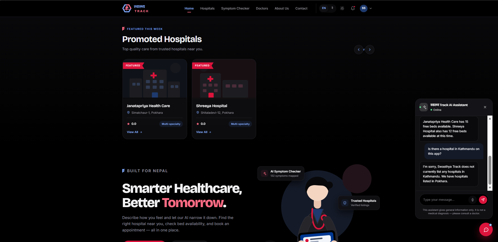
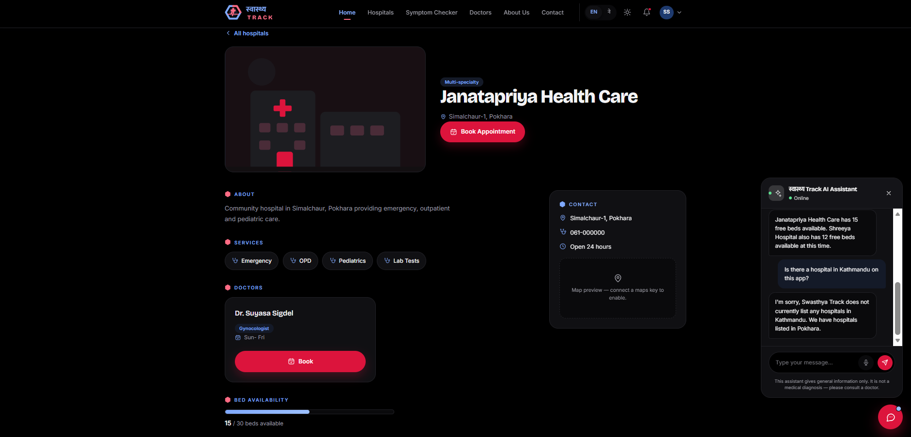
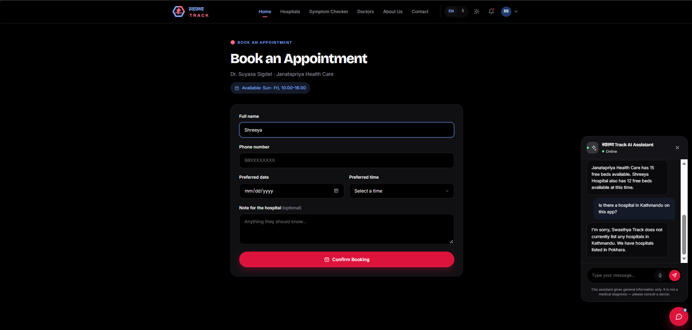
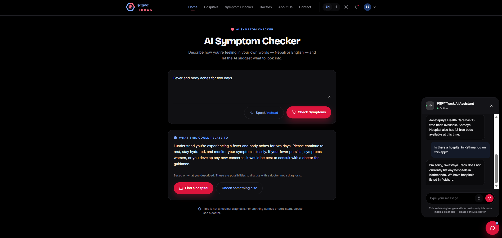
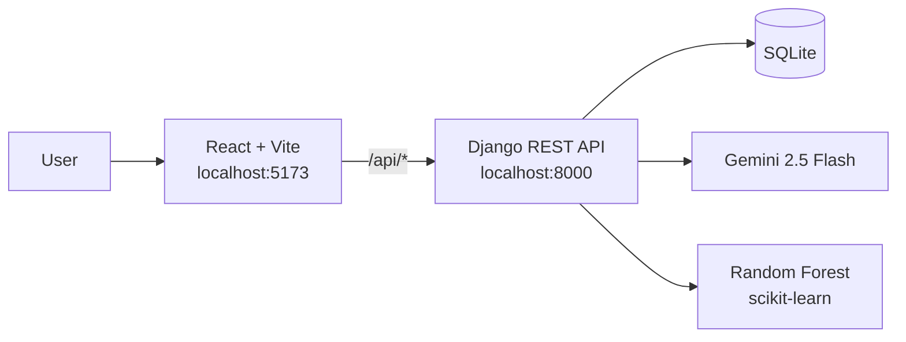

# Swasthya Track (स्वास्थ्य Track)

A bilingual (English / नेपाली) hospital finder and AI health assistant for Nepal. Patients can find hospitals, check bed availability, book appointments with doctors, keep their bookings in a personal account, describe their symptoms in their own words, and talk to a voice assistant that recommends hospitals from real data.

> **Disclaimer:** Swasthya Track gives general information only. It is not a medical diagnosis. Always consult a qualified doctor.






## Features

**Find hospitals.** Search by name or address, filter by city, and sort by rating or free beds. Each hospital page shows its services, doctors, and live bed availability.

**Book appointments.** The time picker only offers slots within the doctor's working hours. The backend validates every booking: no past dates, valid phone numbers, no double booking, and no slots outside the doctor's hours.

**Patient accounts.** Patients sign up with their mobile number and a password. When logged in, the booking form fills in their name and phone, and every booking is saved to their account under "My appointments". Guests can still book without an account. Django hashes the passwords and checks them against its password rules, and the API uses token authentication.

**AI symptom checker.** Patients describe how they feel in English or Nepali. Gemini maps the description to a fixed list of 132 known symptoms, and a Random Forest model predicts the most likely condition. The reply comes with a calm explanation and a disclaimer.

**AI chat assistant.**
- A system prompt sets its role and safety rules: no diagnosis, no medicine doses, and "call 102" for emergencies.
- It remembers the last 10 messages of the conversation.
- Hospital recommendations are grounded in the app's database (a simple form of RAG), so it suggests real hospitals from the app instead of inventing names.
- It replies in the language the user writes in: English, Nepali in Devanagari, or Nepali in Roman letters.

**Voice assistant.** Patients can speak a question in Nepali or English. It is sent as soon as they stop talking, and every reply is read aloud (with a Nepali or Hindi voice for Devanagari text). Any reply can be replayed or stopped with its speaker button.

**Built for Nepal.** Full English/Nepali interface and dark/light themes.

## How it works



**Symptom checker pipeline**

1. The patient writes free text, e.g. "I have had a headache and fever for two days".
2. Gemini returns a short reply and picks matching symptoms from the 132 known names.
3. The symptoms become a 0/1 vector with one position per known symptom.
4. The Random Forest predicts a condition from that vector.

**Chat pipeline**

Each message is sent to Gemini together with the system prompt, the recent conversation history, and a summary of hospitals pulled from the database (services, doctors, free beds).

**Accounts**

When a patient registers or logs in, the backend returns a token. The React app stores it and sends it as an `Authorization: Token ...` header, so the backend knows who is booking and whose appointments to return.

## Tech stack

| Layer | Tools |
|---|---|
| Frontend | React 19, Vite, React Router, Web Speech API (voice input and spoken replies) |
| Backend | Django 5.2, Django REST Framework (token authentication), SQLite |
| AI / ML | Gemini 2.5 Flash (`google-genai`), scikit-learn Random Forest, pandas, joblib |

## Getting started

**Requirements:** Python 3.11+, Node.js 20.19+ (or 22.12+), and a Gemini API key from [Google AI Studio](https://aistudio.google.com/).

### 1. Backend

```bash
git clone https://github.com/shreeya-12shrestha/hospital-app.git
cd hospital-app
python -m venv venv
.\venv\Scripts\Activate.ps1        # macOS/Linux: source venv/bin/activate
pip install -r requirements.txt
```

Create a `.env` file in the project root:

```
GEMINI_API_KEY=your-key-here
```

Set up the database with demo data and start the server:

```bash
python manage.py migrate
python manage.py loaddata demo
python manage.py createsuperuser   # optional, for the admin panel
python manage.py runserver
```

### 2. Frontend

In a second terminal:

```bash
cd hospital-frontend
npm install
npm run dev
```

Open http://localhost:5173. The Vite dev server forwards `/api` requests to Django, so both servers must be running. The admin panel is at http://127.0.0.1:8000/admin/.

### 3. Retrain the disease model (optional)

```bash
cd ml
python train_model.py
```

This rebuilds `disease_model.pkl` and `symptoms.pkl` from `Training.csv`.

## API

| Method | Endpoint | Description |
|---|---|---|
| GET | `/api/hospitals/` | List hospitals. Query params: `search`, `city`, `promoted=true`, `sort=rating\|beds\|name` |
| GET | `/api/hospitals/<id>/` | One hospital with its services and doctors |
| GET | `/api/doctors/` | List doctors. Query params: `hospital`, `specialty`, `search` |
| POST | `/api/appointments/` | Book an appointment. With a token, the booking is linked to the patient's account |
| POST | `/api/symptom-check/` | `{ "symptoms": "...", "lang": "en" \| "ne" }` → reply, predicted condition, matched symptoms |
| POST | `/api/chat/` | `{ "message": "...", "lang": "en" \| "ne", "history": [...] }` → `{ "reply": "..." }` |
| POST | `/api/register/` | `{ "name", "phone", "password" }` → token and user |
| POST | `/api/login/` | `{ "phone", "password" }` → token and user |
| POST | `/api/logout/` | Deletes the token (token required) |
| GET | `/api/me/` | The logged-in patient's name and phone (token required) |
| GET | `/api/my-appointments/` | The logged-in patient's bookings, newest first (token required) |

Endpoints marked "token required" expect an `Authorization: Token <token>` header.

## Project structure

```
hospital-app/
├── hospitalsystem/        Django project settings and URL routes
├── hospitals/             Models, API views, serializers, admin, migrations
│   └── fixtures/demo.json Demo hospitals and doctors
├── ml/                    Training data, training script, saved model
├── hospital-frontend/     React app (pages, chat widget, translations, styles)
└── requirements.txt
```

## Known limitations and roadmap

- The disease model is trained on the full dataset and has no held-out evaluation yet. Next step: a train/test split with accuracy and per-class metrics.
- The training data is a small public dataset, so predictions are not clinically validated.
- Doctor working hours are validated, but working days are still stored as free text.
- Health records are intentionally not built yet. They need stronger protection (encryption, access controls, audit logs) than this prototype has.
- The login token is kept in the browser's localStorage, which is fine for a prototype. A production app would use secure, HTTP-only cookies.
- Spoken replies depend on the voices installed in the browser. Nepali written in Roman letters is read with an English voice.
- Planned: an ambulance locator using hospital coordinates.
- Settings are for local development (`DEBUG = True`) and are not production-ready.

<!-- Add the authors / team members and the dataset source link here, e.g.
## Team
- Shreeya Shrestha (GitHub: shreeya-12shrestha)
- ...

## Acknowledgements
- Symptom–disease dataset: <link to the dataset source>
-->