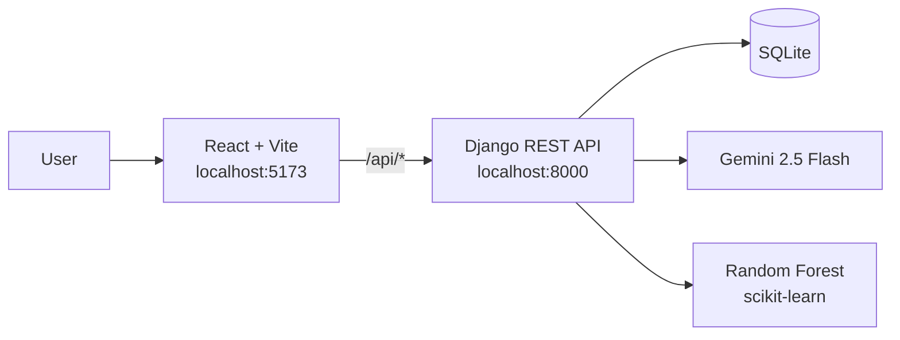

# Swasthya Track (स्वास्थ्य Track)

A bilingual (English / नेपाली) hospital finder and AI health assistant for Nepal. Patients can find hospitals, check bed availability, book appointments with doctors, keep their bookings in a personal account, describe their symptoms in their own words, find the nearest ambulance, and talk to a voice assistant that recommends hospitals from real data.

> **Disclaimer:** Swasthya Track gives general information only. It is not a medical diagnosis. Always consult a qualified doctor.


## Features

**Find hospitals.** Search by name or address, filter by city, and sort by rating or free beds. Each hospital page shows its services, doctors, and live bed availability.

**Book appointments.** The time picker only offers slots within the doctor's working hours, and the form warns when the chosen date is the doctor's day off. The backend validates every booking: no past dates, valid phone numbers, no double booking, and no slots outside the doctor's working days and hours.

**Patient accounts.** Patients sign up with their mobile number and a password, and confirm the number with a 6-digit one-time code. Codes are stored hashed, expire after 5 minutes, allow 5 tries, and can be requested at most once a minute. When logged in, the booking form fills in their name and phone, and every booking is saved to their account under "My appointments". Guests can still book without an account. Django hashes the passwords and checks them against its password rules, and the API uses token authentication.

**AI symptom checker.** Patients describe how they feel in English or Nepali. Gemini maps the description to a fixed list of 132 known symptoms, and a Random Forest model suggests the three most likely conditions, each with how confident the model is. The reply comes with a calm explanation and a disclaimer. The model was checked for data leakage and retrained to cope with patients who mention only a few symptoms (see [Model evaluation](#model-evaluation)).

**AI chat assistant.**
- A system prompt sets its role and safety rules: no diagnosis, no medicine doses, and "call 102" for emergencies.
- It remembers the last 10 messages of the conversation.
- Hospital recommendations are grounded in the app's database (a simple form of RAG), so it suggests real hospitals from the app instead of inventing names.
- It replies in the language the user writes in: English, Nepali in Devanagari, or Nepali in Roman letters.

**Voice assistant.** Patients can speak a question in Nepali or English. It is sent as soon as they stop talking, and every reply is read aloud (with a Nepali or Hindi voice for Devanagari text). Any reply can be replayed or stopped with its speaker button.

**Find an ambulance.** One tap calls 102, Nepal's ambulance number, before anything else loads. The page can also use the browser's location to list the nearest available ambulances with their distance, show them on an OpenStreetMap map, and call one directly. Distances are worked out with the haversine formula.

**Built for Nepal.** Full English/Nepali interface and dark/light themes.

## How it works



**Symptom checker pipeline**

1. The patient writes free text, e.g. "I have had a headache and fever for two days".
2. Gemini returns a short reply and picks matching symptoms from the 132 known names.
3. The symptoms become a 0/1 vector with one position per known symptom.
4. The Random Forest returns its three most likely conditions, with a confidence for each (the share of its 100 trees that voted for it).

**Chat pipeline**

Each message is sent to Gemini together with the system prompt, the recent conversation history, and a summary of hospitals pulled from the database (services, doctors, free beds).

**Accounts**

A new patient first asks for a one-time code, then registers with it. When a patient registers or logs in, the backend returns a token. The React app stores it and sends it as an `Authorization: Token ...` header, so the backend knows who is booking and whose appointments to return.

## Model evaluation

`ml/evaluate.py` checks how good the disease model really is. It found three things:

1. **The first 100% was misleading.** `Training.csv` has 4,920 rows but only 304 unique ones. With a normal random 80/20 split, all 984 test rows also appeared in the training rows, so the test only measured memory.
2. **Even an honest test gives 100%.** After removing the duplicates first (and with 5-fold cross-validation), the model still scores 100%. Every row lists 3 to 17 symptoms, so the conditions are easy to tell apart.
3. **Real patients mention fewer symptoms.** In the app people usually type one to three. Keeping only a few random symptoms of each test row shows the real picture, and training on partial copies of each row (data augmentation) improves it a lot:

| Symptoms the patient mentions | 1 | 2 | 3 | 5 | All |
|---|---|---|---|---|---|
| Model trained on full rows | 39% | 59% | 79% | 92% | 100% |
| Model trained with partial-symptom copies (used in the app) | 50% | 78% | 95% | 96% | 99% |

The test rows are never used for training or augmentation. Because two symptoms often fit more than one condition (for example, headache and high fever give roughly Malaria 44%, Dengue 41%, Typhoid 5%), the app shows the top three instead of a single answer.

## Tech stack

| Layer | Tools |
|---|---|
| Frontend | React 19, Vite, React Router, Web Speech API (voice input and spoken replies), Leaflet with OpenStreetMap (maps) |
| Backend | Django 5.2, Django REST Framework (token authentication), SQLite |
| AI / ML | Gemini 2.5 Flash (`google-genai`), scikit-learn Random Forest, pandas, joblib |

## Getting started

**Requirements:** Python 3.11+, Node.js 20.19+ (or 22.12+), and a Gemini API key from [Google AI Studio](https://aistudio.google.com/).

### 1. Backend

```bash
git clone https://github.com/shreeya-12shrestha/hospital-app.git
cd hospital-app
python -m venv venv
.\venv\Scripts\Activate.ps1        # macOS/Linux: source venv/bin/activate
pip install -r requirements.txt
```

Create a `.env` file in the project root:

```
GEMINI_API_KEY=your-key-here
```

Set up the database with demo data and start the server:

```bash
python manage.py migrate
python manage.py loaddata demo
python manage.py createsuperuser   # optional, for the admin panel
python manage.py runserver
```

### 2. Frontend

In a second terminal:

```bash
cd hospital-frontend
npm install
npm run dev
```

Open http://localhost:5173. The Vite dev server forwards `/api` requests to Django, so both servers must be running. The admin panel is at http://127.0.0.1:8000/admin/.

### 3. Evaluate and retrain the disease model (optional)

```bash
cd ml
python evaluate.py      # how good is the model? (see Model evaluation)
python train_model.py   # rebuild the model the app uses
```

`train_model.py` removes duplicate rows, adds partial-symptom copies, and rebuilds `disease_model.pkl` and `symptoms.pkl` from `Training.csv`. Restart Django afterwards, because it loads the model once at startup.

## API

| Method | Endpoint | Description |
|---|---|---|
| GET | `/api/hospitals/` | List hospitals. Query params: `search`, `city`, `promoted=true`, `sort=rating\|beds\|name` |
| GET | `/api/hospitals/<id>/` | One hospital with its services and doctors |
| GET | `/api/doctors/` | List doctors. Query params: `hospital`, `specialty`, `search` |
| POST | `/api/appointments/` | Book an appointment. With a token, the booking is linked to the patient's account |
| POST | `/api/symptom-check/` | `{ "symptoms": "...", "lang": "en" \| "ne" }` → reply, top condition, top three conditions with confidence (`possible`), matched symptoms |
| POST | `/api/chat/` | `{ "message": "...", "lang": "en" \| "ne", "history": [...] }` → `{ "reply": "..." }` |
| POST | `/api/send-otp/` | `{ "phone" }` → sends a 6-digit code (at most one request a minute) |
| POST | `/api/register/` | `{ "name", "phone", "password", "code" }` → token and user |
| POST | `/api/login/` | `{ "phone", "password" }` → token and user |
| POST | `/api/logout/` | Deletes the token (token required) |
| GET | `/api/me/` | The logged-in patient's name and phone (token required) |
| GET | `/api/my-appointments/` | The logged-in patient's bookings, newest first (token required) |
| GET | `/api/ambulances/nearby/?lat=...&lng=...` | Available ambulances, nearest first, with the distance in km |

Endpoints marked "token required" expect an `Authorization: Token <token>` header.

## Project structure

```
hospital-app/
├── hospitalsystem/        Django project settings and URL routes
├── hospitals/             Models, API views, serializers, OTP helpers, admin, migrations
│   └── fixtures/demo.json Demo hospitals and doctors
├── ml/                    Training data, evaluation and training scripts, saved model
├── hospital-frontend/     React app (pages, chat widget, translations, styles)
└── requirements.txt
```

## Known limitations and roadmap

- The symptom dataset is small and synthetic (304 unique rows for 41 conditions). Even after the fixes above, predictions from one or two symptoms are often uncertain, and none of them are clinically validated.
- Condition names come from the dataset and stay in English in the Nepali interface.
- Verification codes are printed to the Django terminal instead of being sent by SMS. Going live needs an SMS gateway, and only `send_sms` in `hospitals/otp.py` would change.
- Ambulance positions are entered in the admin panel, not tracked live by GPS.
- Health records are intentionally not built yet. They need stronger protection (encryption, access controls, audit logs) than this prototype has.
- The login token is kept in the browser's localStorage, which is fine for a prototype. A production app would use secure, HTTP-only cookies.
- Spoken replies depend on the voices installed in the browser. Nepali written in Roman letters is read with an English voice.
- Planned: live ambulance GPS, a real SMS gateway for the codes, and a public deployment.
- Settings are for local development (`DEBUG = True`) and are not production-ready.

## Team

- Shreeya Shrestha ([shreeya-12shrestha](https://github.com/shreeya-12shrestha))
- Suyasa Sigdel ([SuyasaSigdel01](https://github.com/SuyasaSigdel01))

<!-- Add the dataset source link here, e.g.
## Acknowledgements
- Symptom–disease dataset: <link to the dataset source>
-->